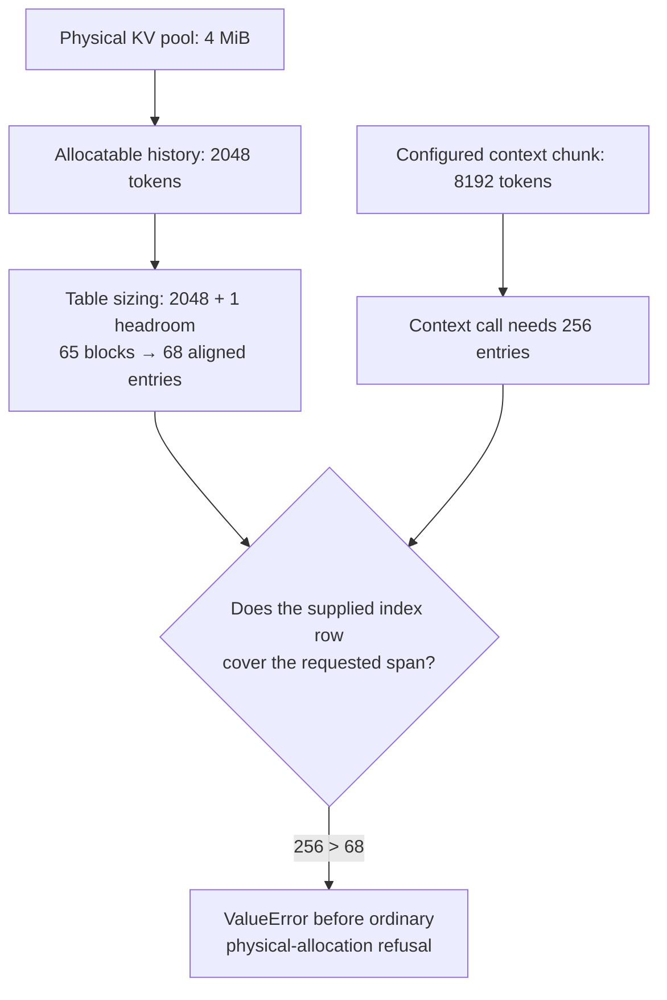

# A 16-GPU KV cache failure, reduced to 4 MiB—and why a larger buffer was not enough

An engineering note on TensorRT-LLM #21470. Revised November 8, 2026.

The first candidate changed one line. The exception disappeared. The GPU still could not satisfy the request.

That distinction became the central question in this investigation: when a KV allocation fails, which layer decides whether the request should ever have reached the allocator?

[Issue #21470](https://github.com/NVIDIA/TensorRT-LLM/issues/21470) was reported by another TensorRT-LLM user running 16 GB300 GPUs. My contribution began with a smaller experiment: one RTX 5080, no model weights, and a 4 MiB KV pool. It reproduced the reported page-index exception through the real C++ allocator. A subsequent review of my initial patch exposed why removing that exception was only part of the problem.

## What had to survive the reduction?

The original deployment used attention data parallelism, expert parallelism, and an internal MoE kernel. According to the report, the kernel's persistent workspace left the KV pool slightly too small for a configured context chunk. Startup and short requests worked. A larger allocation raised `ValueError: User-provided base page indices is too short` in rank 0's executor loop, after which the executor terminated all ranks.

Rebuilding that deployment would have preserved many details unrelated to the immediate exception. The useful clue was where the traceback crossed into native code: `KVCacheManagerV2.resize_context` called the native cache's `resize`. The page-index span was checked before physical page allocation could return an ordinary allocation failure.

That suggested a testable hypothesis: the local exception depended on a mismatch between the requested context span and the manager's index-table width. The MoE workspace was one way to create that mismatch; an explicitly small KV pool could be another.

I retained the Python manager, CUDA buffers, and native C++ allocator. A small request helper supplied the fields used by this path. I removed the model forward pass and distributed communication. This preserved the suspected failure boundary while making the experiment cheap enough to run repeatedly on a consumer card.

## Two capacities that stopped agreeing

The experiment used the issue's official image, `1.4.0rc3.dev202610300406`, with this geometry:

| Input | Value |
| --- | --- |
| GPU | One RTX 5080 |
| KV pool | 4 MiB; no host cache or block reuse |
| Layers / KV heads / head dimension | 2 / 2 / 128 |
| KV dtype / block size | FP16 / 32 tokens |
| Configured sequence length / context token budget | 8192 / 8192 |
| Maximum batch size | 1 |

Each token requires `2 layers × 2 (K and V) × 2 heads × 128 × 2 bytes = 2048 bytes` of KV payload. Dividing 4 MiB by 2048 bytes gives 2048 tokens, which matched the manager's reported allocatable length. The requested 8192-token context required four times that payload.

The historical constructor explicitly clamps its local sequence limit to what the pool can hold. It then sizes the page-index table from that clamped limit. These are exact excerpts, with intervening logging and comments omitted, from the [issue-version constructor](https://github.com/NVIDIA/TensorRT-LLM/blob/ac6fb72d9fa1caf2b2d730aa4797727e6b3f6d23/tensorrt_llm/_torch/pyexecutor/kv_cache/kv_cache_manager_v2.py#L2480):

```python
max_num_tokens = self.get_num_available_tokens(token_num_upper_bound=max_seq_len)
# ...
self.max_seq_len = int(max_num_tokens)
# ...
max_seq_capacity = self.max_seq_len + self._generation_kv_capacity_headroom
self.max_blocks_per_seq = (
    max_seq_capacity + self._ledger_tokens_per_block - 1
) // self._ledger_tokens_per_block
if self.max_blocks_per_seq % 4 != 0:
    self.max_blocks_per_seq = ((self.max_blocks_per_seq + 3) // 4) * 4
```

For this non-speculative configuration, [generation headroom is one token](https://github.com/NVIDIA/TensorRT-LLM/blob/ac6fb72d9fa1caf2b2d730aa4797727e6b3f6d23/tensorrt_llm/_torch/pyexecutor/kv_cache/kv_cache_manager_v2.py#L654). The table must cover the possible generation lead beyond the history length, rather than only the history itself; speculative configurations can need a larger reserve. The constructor also rounds the width to a multiple of four for the block-offset copy kernel.

Define `align4(n) = 4 × ceil(n / 4)`. The original width was therefore:

$$
W_{original}=\operatorname{align4}\left(\left\lceil\frac{2048+1}{32}\right\rceil\right)
=\operatorname{align4}(65)=68.
$$

Clamping `self.max_seq_len` did not itself reject the externally supplied context chunk. In the [historical resize path](https://github.com/NVIDIA/TensorRT-LLM/blob/ac6fb72d9fa1caf2b2d730aa4797727e6b3f6d23/tensorrt_llm/_torch/pyexecutor/kv_cache/kv_cache_manager_v2.py#L5254), the target was still computed from the request:

```python
target = req.context_current_position + num_tokens + self.num_extra_kv_tokens
capacity = max(kv_cache.capacity, target)
```

This experiment started at position zero and requested 8192 context tokens; [speculative extras are zero without a speculative configuration](https://github.com/NVIDIA/TensorRT-LLM/blob/ac6fb72d9fa1caf2b2d730aa4797727e6b3f6d23/tensorrt_llm/_torch/speculative/utils.py#L775). Its context span required 256 page-index entries. The one-token generation headroom used in table sizing is a separate quantity: it does not turn this context call into an 8193-token request.



The table stores page indices, not KV payload. Its four-entry padding adds metadata slots; it does not add physical pages. The defect at this boundary was that a request could reach native resize with a span wider than the metadata supplied for it.

## The original exception, on one card

The archived baseline printed `allocatable_max_seq_len: 2048`, `max_blocks_per_seq: 68`, and page-table shape `[1, 3, 2, 68]`. Its backend was the native `tensorrt_llm.bindings.internal.batch_manager.kv_cache_manager_v2.KVCacheManager`.

The relevant end of the recorded traceback was:

```text
  File "/usr/local/lib/python3.12/dist-packages/tensorrt_llm/_torch/pyexecutor/kv_cache/kv_cache_manager_v2.py", line 5265, in resize_context
    kv_cache.resize(capacity, history) if history is not None else kv_cache.resize(capacity)
                                                                   ^^^^^^^^^^^^^^^^^^^^^^^^^
ValueError: User-provided base page indices is too short
```

This was the useful result of the reduction: the same exception text at the same local allocation boundary, without the original hardware topology or model. It made the capacity mismatch directly observable.

## The tempting one-line patch

The first candidate used configured `max_seq_len`, rather than clamped `self.max_seq_len`, when calculating table width. That changed the calculation to:

$$
W_{candidate}=\operatorname{align4}\left(\left\lceil\frac{8192+1}{32}\right\rceil\right)
=\operatorname{align4}(257)=260.
$$

Now the 256-entry context span fit inside the table. Physical capacity was still 2048 tokens. The allocator could reach its normal resource-failure path and return `False`.

| Recorded observation | Original image | Initial wider-table candidate |
| --- | --- | --- |
| Index-row width | 68 | 260 |
| Allocatable token capacity | 2048 | 2048 |
| 8192-token context allocation | `ValueError` | `False` |
| Capacity and history after refusal | Exception interrupted the test | Unchanged |
| Prepare again, explicitly request 32 tokens | Not reached by the test | Succeeded |

The candidate regression passed: `1 passed, 45 warnings in 6.93s`. It established a useful local contract—refusal without corrupting cache state, followed by a successful smaller allocation. The test itself chose the smaller retry. It did not demonstrate that the scheduler would choose one.

The archived patched-run harness printed this summary after its assertions completed:

```text
PATCHED GPU REGRESSION PASSED: refusal, unchanged state, suspension, resume and short allocation
```

The assertions behind that line check the `False` return, unchanged capacity and history, suspension after the first-chunk refusal, and a successful explicit 32-token retry. The log reports their combined success rather than printing each value separately.

## Review changed the question

Reviewer **sunnyqgg** identified the remaining lifecycle problem in [the PR review](https://github.com/NVIDIA/TensorRT-LLM/pull/21720#pullrequestreview-5812542254): a permanently infeasible request could still enter scheduling. Replacing an exception with `False` could leave the scheduler repeatedly skipping or preempting work until its stall handling failed later. The review also raised table-memory, copy-cost, and existing 32-bit indexing concerns with scaling metadata to configured context length.

Those were review findings, not results of my initial allocator experiment. They changed the acceptance criterion. A safe allocator refusal answers “can I allocate this now?” Admission must also answer “can this request ever fit under this manager's constraints?”

Temporary contention and permanent infeasibility need different treatment. A request that fits total capacity may succeed after another request releases pages. A request larger than total capacity cannot be made runnable by waiting. Widening an index table changes neither fact.

| Condition | Required handling |
| --- | --- |
| Demand fits total physical capacity, but free pages are temporarily insufficient | Wait or retry as pages become available |
| Demand exceeds total physical capacity | Reject at admission where the manager supports physical-demand estimation |
| The request span exceeds the fixed page-index row | Reject at admission; also guard direct callers before native resize |

The [current proposal at commit 1726699](https://github.com/NVIDIA/TensorRT-LLM/pull/21720/commits/1726699312807e945875b7669692182a6cc05d65) therefore keeps table sizing bounded and adds request admission checks. For supported dense configurations, it compares estimated demand with total physical capacity rather than currently free pages. An independent index-span budget rejects requests that exceed the fixed per-beam row. A pre-resize check also protects direct callers by returning allocation failure before native resize can overrun that span.

The PR description reports 39 targeted cases, including admission/scheduler regressions and native GPU cases. That evidence belongs to the admission proposal, separately from the historical one-test wider-table result.

## Reproduce the experiment—and keep its boundary visible

The archived [reproducer.py](reproducer.py) is the exact standalone regression previously executed. Against the unmodified issue-version wheel, its expected `False` assertion instead encounters the original `ValueError`: that failing test is the baseline reproduction. Its recorded pass belongs to the historical one-line candidate. It is not a bundled comparison runner for the current admission implementation; use the pinned PR's tests for that.

In a prepared CUDA container with that image and pytest installed, run:

```sh
python -m pytest -c /dev/null --noconftest -q reproducer.py
```

An import failure or CUDA skip is not reproduction. [results.md](results.md) preserves the image digest, source revision, script and module hashes, archived invocation, and validation details.

The remaining boundary is specific: this reduction exercises the local allocation path, not model execution or the 16-rank shutdown. The current PR's 39-case report uses an isolated compatibility harness with the issue-version allocator; full modules with a matching build, official CI, and the original deployment remain separate validation work. Physical-demand admission also has configuration limits documented in the PR.

The engineering lesson is the gap between two contracts. The allocator must reject an invalid span safely. The serving system must prevent permanently impossible work from entering a retry loop. A small native reproducer made the first contract visible; review and scheduler-level tests forced the second into the fix.
